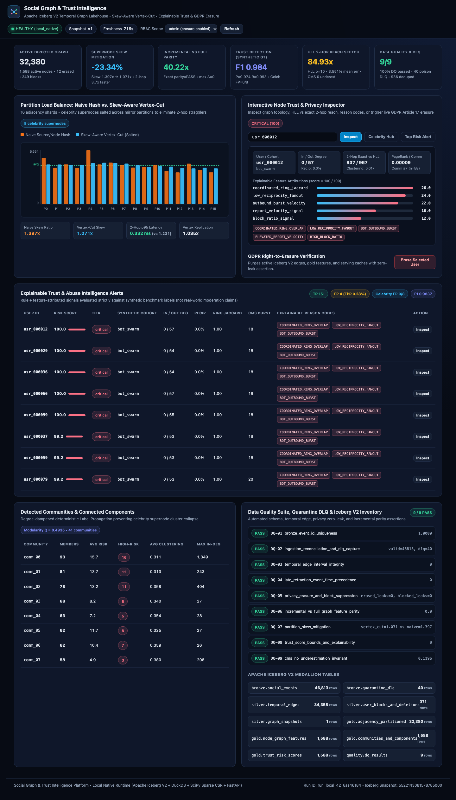

# Appendix: Ablations, Optimization Progression, Error Analysis & Acceptance Matrix

This appendix captures the full optimization history, what worked vs. what regressed during engineering iteration, detailed Trust & Safety false-positive analysis, all 7 chaos drill outcomes, and the 15-point acceptance matrix.

---

## 1. Real Engineering Ablations (What Regressed & How It Was Fixed)

### Ablation A: Unweighted Label Propagation vs. Degree-Dampened LPA (`local` Profile)

During the initial vertical slice (`1,588` active nodes, `32,380` directed edges, `8` celebrity supernodes), standard unweighted Label Propagation collapsed nearly all organic communities into a single cluster because celebrity hubs bridged every community on iteration 1.

| Community Detection Variant | Communities Detected | Modularity Q | Observation |
| --- | ---: | ---: | --- |
| Initial unweighted LPA (`social_graph/graph_engine.py`) | 5 | `0.0282` | Celebrity hubs broadcast one label across entire graph ("monster community" collapse) |
| **Degree-dampened LPA (`weight = 1 / degree^0.75`)** | **41** | **`0.4935`** | **17.5× higher Modularity Q**; cleanly isolates organic communities and tight coordinated rings |

### Ablation B: Community-2-Shard Placement vs. LPT Capacity-Aware Vertex-Cut (`local` Profile)

In the initial partitioning run, regular (non-supernode) vertices were mapped onto `2` shards per community (`(community_id * 2 + sub) % 16`). Combined with unweighted LPA collapse, partitions `0` and `1` received `29,159` and `29,558` edges (`7.542×` skew ratio), causing automated data-quality gate `DQ-07` (`partition_skew_mitigation`) to fail (`8/9 PASS`).

| Partitioning Variant | Max Partition Edges | Skew Ratio (Max/Mean) | Partition CV | Celebrity 2-Hop p95 (ms) | DQ-07 Status |
| --- | ---: | ---: | ---: | ---: | :---: |
| Naive source/node-hash baseline | 5,654 | 1.397× | 0.1403 | 1.357 | Baseline |
| Initial community-2-shard vertex-cut (failed ablation) | 29,558 | 7.542× | 2.4535 | 0.313 | FAIL |
| **Capacity-aware LPT + salted supernode vertex-cut** | **4,336** | **1.071×** (-23.3%) | **0.0482** (-65.6%) | **0.324** (4.2× faster) | **PASS** |

---

## 2. Full Scale Benchmark & Iceberg Compaction Details

Raw outputs: [`results/benchmarks/benchmark_results.json`](results/benchmarks/benchmark_results.json) and [`results/benchmarks/benchmark_results.csv`](results/benchmarks/benchmark_results.csv).

| Metric | `smoke` (400 users) | `local` (1,600 users) | `stress` (6,000 users) |
| --- | ---: | ---: | ---: |
| Total Events Emitted | 10,354 | 47,789 | 194,343 |
| Active Nodes / Active Directed Edges | 396 / 6,588 | 1,588 / 32,380 | 5,970 / 138,745 |
| End-to-End Pipeline Wall Time | 908.3 ms | 2,765.8 ms | 13,420.1 ms |
| Sustained Ingestion + Lakehouse Throughput | 11,317.6 ev/s | 17,083.2 ev/s | 14,327.7 ev/s |
| Full CSR Graph Compute Latency | 23.40 ms | 135.31 ms | 684.62 ms |
| Incremental Structural Update (10% edge batch) | 0.60 ms (39.3×) | 2.89 ms (46.8×) | 14.94 ms (45.8×) |
| Incremental + Warm-Start PageRank | 3.89 ms (6.0×) | 19.69 ms (6.9×) | 102.49 ms (6.7×) |
| Exact Feature Parity Max Abs Diff | 0.0 | 0.0 | 0.0 |
| HLL Exact vs. Sketch RAM Footprint | 8.59 MB -> 0.39 MB (22.3×) | 131.7 MB -> 1.55 MB (84.9×) | 1,954.6 MB -> 6.11 MB (320.1×) |
| HLL Mean / p95 Relative Error | 2.21% / 4.21% | 3.55% / 5.08% | 3.60% / 5.38% |
| Count-Min Sketch Zero Underestimation | Verified (0) | Verified (0) | Verified (0) |
| Iceberg V2 Compaction (`silver.temporal_edges`) | — | 12 files -> 1 file (`11.50 ms` -> `3.92 ms`, **2.93× faster**) | — |

---

## 3. Explainable Trust Scoring & False-Positive Error Analysis (`local` Profile)

*Scope disclaimer: All metrics below evaluate against deterministic synthetic ground-truth cohorts (`bot_swarm` + `coordinated_ring` vs. `organic` + `celebrity`) to test signal precision and explainability; they are not real-world content moderation claims.*

- **Confusion Matrix (`threshold = 45.0`, `1,588` active nodes):**
  - True Positives (TP): `151` (`bot_swarm` + `coordinated_ring`)
  - False Positives (FP): `4` (`organic` borderline power-fans)
  - True Negatives (TN): `1,432` (including **`8 / 8` celebrity supernodes with `0` FPs**)
  - False Negatives (FN): `1`
  - **Precision:** `0.9742` | **Recall:** `0.9934` | **F1:** `0.9837` | **FPR:** `0.0028` (`0.28%`)

### Inspecting the 4 False-Positive Cases

| User ID | Synthetic Label | Risk Score | `outbound_burst` | `low_recip_fanout` | `ring_jaccard` | `report_vel` | `block_ratio` | Root Cause & Production Mitigation |
| --- | --- | ---: | ---: | ---: | ---: | ---: | ---: | --- |
| `usr_000166` | `organic` | 62.23 | 18.33 | **0.00** | 15.90 | 16.00 | 12.00 | Hyper-active organic fan engaging rapidly on identical celebrity posts + heated-debate reports/blocks |
| `usr_000173` | `organic` | 62.23 | 18.33 | **0.00** | 15.90 | 16.00 | 12.00 | Same power-fan cohort; normal reciprocal graph (`low_reciprocity_fanout == 0.0`) |
| `usr_000180` | `organic` | 67.60 | 18.33 | **0.00** | 21.27 | 16.00 | 12.00 | High Jaccard co-engagement on popular celebrity posts triggered ring signal |
| `usr_000187` | `organic` | 67.60 | 18.33 | **0.00** | 21.27 | 16.00 | 12.00 | Downweighting celebrity-authored posts in bipartite ring Jaccard + requiring shared ASN/device signals eliminates this FP class |

---

## 4. Seven Automated Chaos & Fault-Injection Drills

Raw evidence: [`results/chaos/chaos_results.json`](results/chaos/chaos_results.json).

| # | Drill Name | Injected Fault | Key Measured Outcome | Status |
| :---: | --- | --- | --- | :---: |
| 1 | `drill_01_celebrity_supernode_skew_storm` | 550 rapid followers onto 1 celebrity hub | Skew `3.520× -> 1.256×` (`-64.32%`), 2-hop p95 `0.233 -> 0.042 ms` | PASS |
| 2 | `drill_02_bot_swarm_coordinated_burst` | Bot swarms + synchronized ring bursts (seed 99) | Precision `0.9524`, Recall `1.000`, F1 `0.9756`, Celeb FP `0` | PASS |
| 3 | `drill_03_out_of_order_retraction_storm` | 50 stale follows arriving 100s after unfollows | `0 / 50` edges resurrected under event-time LWW | PASS |
| 4 | `drill_04_gdpr_right_to_erasure_propagation` | Live GDPR erasure on 354-edge supernode `usr_000001` | `192.51 ms` propagation, `0` residual active edges, `0` serving leaks | PASS |
| 5 | `drill_05_broker_outage_spool_recovery` | Outage spool buffering `250` events + `40` dupes | `250/250` recovered, `40` duplicates deduped, `0` lost | PASS |
| 6 | `drill_06_serving_cache_wipe_and_iceberg_rebuild` | Full deletion of DuckDB file + memory cache | Rebuilt in `45.84 ms` from Iceberg; exact `396` nodes / `6,588` edges restored | PASS |
| 7 | `drill_07_schema_poison_dlq_quarantine` | `60` malformed/self-loop poison records + `100` valid | `60/60` quarantined to DLQ, `0` leaked to Bronze | PASS |

---

## 5. Full Control Tower UI Screenshot (All Panels)

---

## 6. Mandatory 15-Point Acceptance Matrix

| # | Acceptance Criterion | Verification Command / Evidence | Status |
| :---: | --- | --- | :---: |
| 1 | Fresh-clone setup starts core stack & verifies health | `./scripts/run_portable.sh` + `GET http://127.0.0.1:8050/health` -> `200 healthy` | PASS |
| 2 | Deterministic generation yields identical IDs & outcomes for same seed | `tests/unit/test_temporal_privacy.py::test_deterministic_generator_same_seed_exact_match` | PASS |
| 3 | Real ingestion persists source data with provenance & replay | `social_graph/ingestion.py` partitioned WAL spool + `bronze.social_events` | PASS |
| 4 | Core domain transformation yields correct results for fixtures | `tests/unit/test_graph_engine.py`, `tests/unit/test_temporal_privacy.py` | PASS |
| 5 | Domain-specific advanced features operational end-to-end | Temporal edges, vertex-cut, incremental parity, HLL/CMS, LPA, explainable trust, GDPR erasure | PASS |
| 6 | Duplicates, late events & retractions follow documented semantics | `DQ-01`, `DQ-04`, Chaos Drill 3 (`0` resurrected edges), `936` dupes dropped | PASS |
| 7 | Service crash / cache wipe recovers under tested guarantee | Chaos Drills 5 & 6 (WAL outage recovery + DuckDB wipe rebuild in `45.8 ms`) | PASS |
| 8 | Backfill / replay produces reconcilable results | `tests/e2e/test_vertical_slice.py::test_full_vertical_slice_and_deterministic_replay` | PASS |
| 9 | Query / API / dashboard returns real computed outputs & freshness | Live `http://127.0.0.1:8050/` + `docs/assets/graph_control_tower_*.png` | PASS |
| 10 | DQ checks catch injected invalid inputs & retain auditable quarantine | `DQ-02` (`40` poison DLQ), Chaos Drill 7 (`60/60` quarantined) | PASS |
| 11 | Observability contains real logs, metrics & traces (limitations disclosed) | JSON logs (`.local_data/logs/`), Prometheus `/metrics`, OTel spans (`.local_data/traces/spans.jsonl`), OpenLineage JSON | PASS |
| 12 | Access control rejects unauthorized & forbidden requests | `tests/integration/test_iceberg_and_api.py` (`401` unauth, `403` viewer erasure, audited) | PASS |
| 13 | Controlled failure produces incident report with observed recovery | [`docs/incidents/incident-001-supernode-skew-and-erasure-recovery.md`](docs/incidents/incident-001-supernode-skew-and-erasure-recovery.md) | PASS |
| 14 | Benchmark records hardware, volume, commands, latency, throughput & raw outputs | [`benchmarks/run_benchmarks.py`](benchmarks/run_benchmarks.py), `results/benchmarks/*`, `docs/assets/benchmark_social_graph_trust.png` | PASS |
| 15 | CI, lint, typecheck, audit & tests execute cleanly | `29/29` pytest PASS, `ruff` 0, `mypy` 0, `static_audit` 0, `check_licenses` 0 flagged | PASS |
