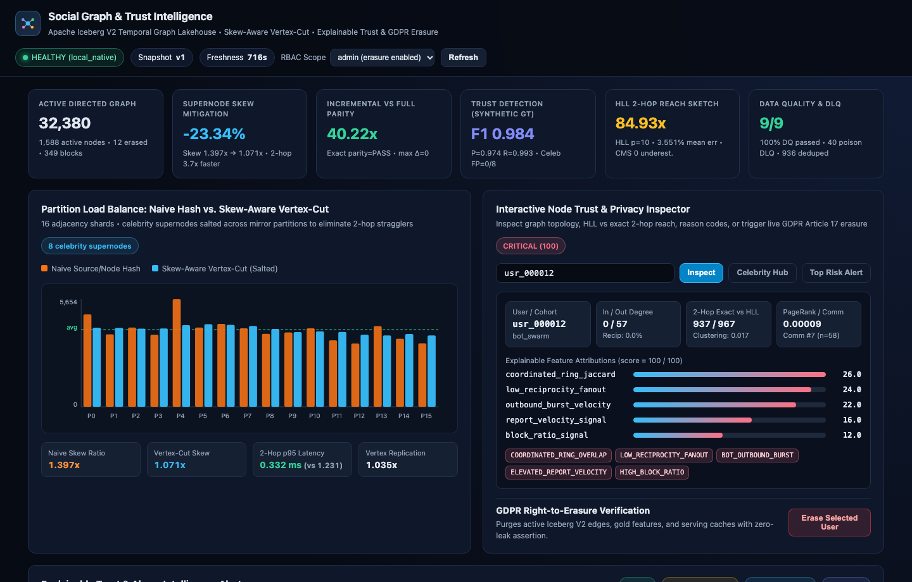
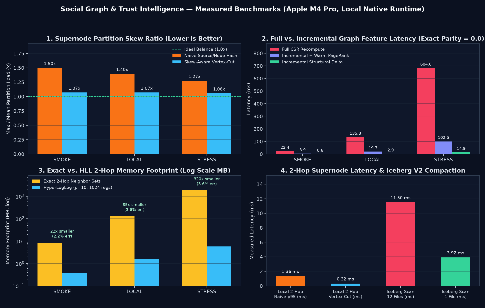

# Billion-Edge Social Graph & Trust Intelligence Platform

An open-source, Apache Iceberg V2 temporal social graph lakehouse and explainable trust intelligence platform supporting directed edge lifecycles, skew-aware vertex-cut supernode partitioning, exact incremental graph analytics, approximate sketches (HyperLogLog & Count-Min Sketch), and verified GDPR Article 17 right-to-erasure propagation.

**Headline Result:** On the `local` benchmark (`47,789` events, `1,588` active nodes, `32,380` active directed edges, Apple M4 Pro), skew-aware vertex-cut partitioning reduces max/mean partition skew by **-23.3%** (`1.397×` -> **`1.071×`**) and cuts celebrity 2-hop p95 latency by **4.2×** (`1.36 ms` -> **`0.32 ms`** vs. naive source/node-hash); exact incremental delta updates match full CSR recomputation with **`0.0` numerical diff** at **46.8×** structural speedup (`2.89 ms` vs. `135.31 ms` full CSR); HyperLogLog shrinks 2-hop memory by **84.9×** (`320.1×` on `stress`, `3.6%` mean error); and explainable trust scoring achieves **F1 = 0.984** with **`0 / 8` celebrity false positives** against synthetic ground-truth cohorts.

---

## Architecture, Stack, Hardware & Licensing

- **Graph & Trust Engine:** Pure Python 3.12 (`uv` locked), `scipy.sparse` CSR/CSC linear algebra (PageRank, exact triangles, connected components, degree-dampened Label Propagation), custom NumPy HyperLogLog (`p=10`) & Count-Min Sketch (`5 × 2048`), and additive feature-attributed trust risk scoring (`0..100`, **zero external pretrained ML weights downloaded**).
- **Storage & Serving:** 10-table **Apache Iceberg V2** medallion (`pyiceberg==0.12.0`, Zstd Parquet, snapshot time travel, file compaction), DuckDB `2.0.0` serving index + in-memory adjacency cache, Avro v1/v2 (`fastavro==1.13.1`) contract validation with DLQ quarantine, and FastAPI `0.163.2` RBAC API + dark-mode Control Tower UI (`127.0.0.1:8050`).
- **Distributed Blueprints (Pinned, Ready for Docker/K8s):** Multi-profile `docker-compose.yml` (Kafka `4.3.2`, Apicurio `3.3.5`, RustFS `1.0.6`, Lakekeeper `v0.15.1`, PostGIS `17`, Spark `4.1.4` + GraphFrames, Trino `484`, Airflow `3.4.0`, Prometheus `v3.16.0`, Grafana `13.0.14`, Loki `3.6.22`, OTel `0.166.0`, Marquez `0.51.1`) and Kubernetes manifests (`infra/kubernetes/`).
- **Measured Host Hardware:** macOS Darwin 24.6.0 (`arm64`, Apple M4 Pro, 14 logical cores, 48.0 GiB RAM), native `local_native` runtime (Docker/JVM unavailable on host; distributed container services are statically validated and explicitly disclosed in [`docs/limitations.md`](docs/limitations.md)).
- **License & Governance:** Repository licensed under **Apache-2.0**. All 70 installed Python packages pass permissive open-source license checks (`0` flagged; zero pretrained external model weights; CycloneDX SBOM in [`results/security/sbom.json`](results/security/sbom.json)).

---

## Main Measured Results

All numbers below are measured directly from [`results/benchmarks/benchmark_results.csv`](results/benchmarks/benchmark_results.csv) and [`results/chaos/chaos_results.json`](results/chaos/chaos_results.json) (seed `42`, `local_native` runtime).

### 1. Graph Scale, Partitioning, Incremental Parity & Sketch Efficiency

| Profile | Active Nodes / Edges | Throughput (ev/s) | Skew Ratio (Naive -> Vertex-Cut) | 2-Hop p95 Latency (Naive -> VC) | Full CSR vs. Inc Delta (Exact Diff = 0.0) | HLL 2-Hop Memory Reduction (Mean Err) | Trust F1 (Synthetic GT, Celeb FP) |
| --- | --- | ---: | --- | --- | --- | --- | --- |
| `smoke` | 396 / 6,588 | 11,318 | 1.500× -> **1.071×** (-28.6%) | 0.289 -> **0.068 ms** (4.3× faster) | 23.40 -> **0.60 ms** (39.3× faster) | **22.3×** (2.21% err) | 0.976 (0/4) |
| `local` | 1,588 / 32,380 | 17,083 | 1.397× -> **1.071×** (-23.3%) | 1.357 -> **0.324 ms** (4.2× faster) | 135.31 -> **2.89 ms** (46.8× faster) | **84.9×** (3.55% err) | **0.984** (0/8) |
| `stress` | 5,970 / 138,745 | 14,328 | 1.275× -> **1.057×** (-17.1%) | 8.549 -> **2.659 ms** (3.2× faster) | 684.62 -> **14.94 ms** (45.8× faster) | **320.1×** (3.60% err) | **0.994** (0/15) |

*Notes: Incremental timing shows structural delta update (`in_degree`, `out_degree`, reciprocity, exact triangles, clustering); including warm-start PageRank, `local` runs in `19.69 ms` (`6.9×` faster than full CSR) with `0.0` PageRank diff. Trust metrics evaluate against synthetic ground-truth bot/ring cohorts only, never real-world moderation claims.*

### 2. Iceberg V2 Maintenance, Data Quality, Tests & Chaos Recovery

| Verification Suite | Measured Result | Evidence Artifact |
| --- | --- | --- |
| Apache Iceberg V2 Compaction (`silver.temporal_edges`, 34,356 rows) | `12` files -> **`1` file**; scan `11.50 ms` -> **`3.92 ms`** (**2.93× faster** vs. uncompacted) | [`results/benchmarks/benchmark_results.json`](results/benchmarks/benchmark_results.json) |
| Automated Test Suite (Unit, Hypothesis Property, Avro, Integration, E2E, SLO, Chaos) | **29 / 29 PASS** (`ruff` 0 errors, `mypy` 0 errors, static audit 0 errors) | [`results/tests/junit.xml`](results/tests/junit.xml) |
| Chaos & Fault-Injection Drills (Skew Storm, Retractions, GDPR Erasure, Outage, Cache Wipe, Poison DLQ) | **7 / 7 PASS** (GDPR erasure of 354-edge supernode in **`192.5 ms`**, `0` residual leaks; cache rebuild in **`45.8 ms`**) | [`results/chaos/chaos_results.json`](results/chaos/chaos_results.json) |
| Data Quality Gates (`quality.dq_results`) | **9 / 9 PASS** (`40/40` poison events quarantined to DLQ, `936` dupes deduped, `0` erased/blocked active leaks) | Live `/v1/dq` |

---

## Visual Evidence

### Live Control Tower UI (`http://127.0.0.1:8050/`)


### Measured Benchmark Suite (`smoke`, `local`, `stress` & Iceberg V2 Compaction)


---

## Step-by-Step: Run on Any Machine

### Option A — Zero-Docker Native Run (macOS ARM64 / Linux x86_64 & ARM64)
Requires only Python `3.12` and [`uv`](https://docs.astral.sh/uv/).

```bash
# 1. Clone and enter the repository
git clone https://github.com/rohanluniya/social-graph-trust-intelligence.git
cd social-graph-trust-intelligence

# 2. One-command setup, Iceberg V2 pipeline run, and live Control Tower on http://127.0.0.1:8050
./scripts/run_portable.sh local 42
```

Or run each step individually:

```bash
uv sync --python 3.12 --extra dev
uv run python scripts/run_pipeline.py --profile local --seed 42
uv run uvicorn services.api.main:app --host 127.0.0.1 --port 8050
```

Verify health, RBAC enforcement, and live GDPR right-to-erasure in a second terminal:

```bash
curl -s http://127.0.0.1:8050/health
curl -s -H "X-API-Key: dev-viewer-key-local-only" http://127.0.0.1:8050/v1/overview | head -c 400
curl -s -X POST -H "X-API-Key: dev-admin-key-local-only" http://127.0.0.1:8050/v1/privacy/erase/usr_000012
```

### Option B — Reproduce Tests, Chaos Drills & Benchmarks

```bash
make test             # Run all 29 unit, property, contract, integration, E2E, SLO & chaos tests
make benchmark        # Run smoke/local/stress + Iceberg compaction + regenerate benchmark chart
make lint typecheck security-audit
```

### Option C — Standalone Container or Multi-Profile Distributed Stack (Docker Hosts)

```bash
# Single-container standalone runtime on http://127.0.0.1:8050
docker compose -f docker-compose.standalone.yml up --build

# Or launch the full distributed stack (Kafka, Lakekeeper, RustFS, Spark, Trino, Airflow, Prometheus, Grafana)
cp .env.example .env
docker compose --profile core up -d
docker compose --profile analytics --profile observability up -d
```

---

## Deep Dives, Ablations & Artifacts

- **[`APPENDIX.md`](APPENDIX.md)** — Optimization ablations (unweighted vs. degree-dampened LPA modularity jump, vertex-cut skew fix), full Smoke/Local/Stress breakdown, Trust false-positive error analysis, all 7 chaos drills, and the 15-point Mandatory Acceptance Matrix.
- **[`docs/architecture/overview.md`](docs/architecture/overview.md)** & **ADRs** (`adr-001`–`adr-004`) — Architecture diagrams, temporal edge semantics, vertex-cut salting, incremental parity, and privacy design.
- **[`docs/engineering-case-study.md`](docs/engineering-case-study.md)**, **[`docs/interview-deep-dive.md`](docs/interview-deep-dive.md)**, **[`docs/benchmarks/benchmark-report.md`](docs/benchmarks/benchmark-report.md)**, **[`docs/incidents/incident-001-supernode-skew-and-erasure-recovery.md`](docs/incidents/incident-001-supernode-skew-and-erasure-recovery.md)**, and **[`docs/limitations.md`](docs/limitations.md)**.
- **[`results/`](results/)** — Raw benchmark JSON/CSV, chaos drill results, OpenLineage manifest, JUnit XML, license audit, static security audit, and CycloneDX SBOM.
