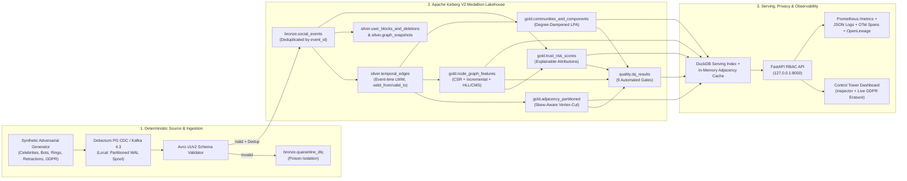
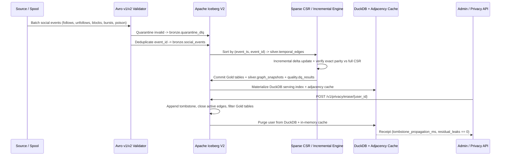

# Architecture Overview & Design Decisions

## Component & Failure-Domain Architecture

## Core Workflow Sequence (Ingestion, Incremental Update & GDPR Erasure)

## Architecture Decision Records (ADRs)

- [ADR-001: Apache Iceberg V2 Temporal Edge Modeling](adr-001-iceberg-temporal-edges.md)
- [ADR-002: Skew-Aware Vertex-Cut Supernode Partitioning](adr-002-skew-aware-vertex-cut.md)
- [ADR-003: Incremental Graph Feature Updates & Approximate Sketches](adr-003-incremental-graph-and-sketches.md)
- [ADR-004: Explainable Trust Intelligence & GDPR Erasure Propagation](adr-004-explainable-trust-and-privacy.md)
