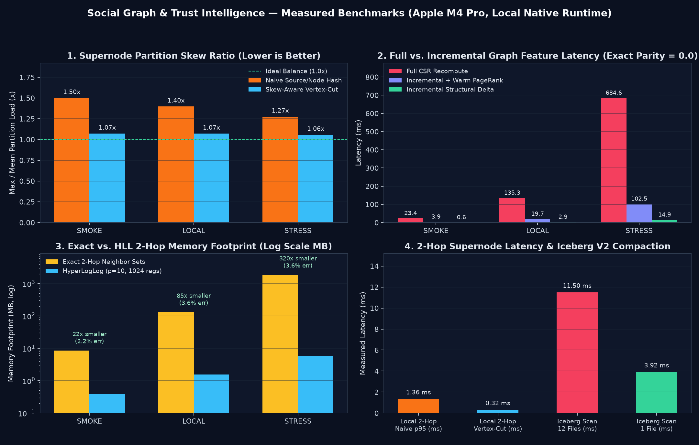

# Benchmark Report (Raw Measured Results)

All benchmarks were executed natively via `uv run python benchmarks/run_benchmarks.py` on **macOS Darwin 24.6.0 (`arm64`, Apple M4 Pro, 14 logical cores, 48.0 GiB RAM, Python 3.12.8)**. Raw evidence is stored in `results/benchmarks/benchmark_results.json` and `results/benchmarks/benchmark_results.csv`.

## 1. End-to-End Scale Profile Comparison

| Profile | Total Events | Active Nodes | Active Edges | Total Pipeline (ms) | Throughput (ev/s) | Modularity Q | Trust F1 (Synthetic GT) | Celebrity FP | DQ Gate |
| --- | ---: | ---: | ---: | ---: | ---: | ---: | ---: | ---: | :---: |
| `smoke` | 10,354 | 396 | 6,588 | 908.3 | 11,317.6 | 0.4385 | 0.9756 | 0 / 4 | 9/9 |
| `local` | 47,789 | 1,588 | 32,380 | 2,765.8 | 17,083.2 | 0.4935 | 0.9837 | 0 / 8 | 9/9 |
| `stress` | 194,343 | 5,970 | 138,745 | 13,420.1 | 14,327.7 | 0.5358 | 0.9936 | 0 / 15 | 9/9 |

## 2. Partitioning, Incremental Parity & Sketch Efficiency

| Profile | Naive Skew | Vertex-Cut Skew | Skew Reduction | 2-Hop p95 Naive vs. VC (ms) | Full CSR vs. Inc Struct (ms) | Struct Speedup | Exact Parity Diff | HLL Mem Reduction | HLL Mean Err |
| --- | ---: | ---: | ---: | --- | --- | ---: | ---: | ---: | ---: |
| `smoke` | 1.500× | **1.071×** | -28.60% | 0.289 vs **0.068** (4.25×) | 23.40 vs **0.60** | 39.27× | 0.0 | 22.3× | 2.21% |
| `local` | 1.397× | **1.071×** | -23.34% | 1.357 vs **0.324** (4.19×) | 135.31 vs **2.89** | 46.83× | 0.0 | 84.9× | 3.55% |
| `stress` | 1.275× | **1.057×** | -17.10% | 8.549 vs **2.659** (3.22×) | 684.62 vs **14.94** | 45.82× | 0.0 | **320.1×** | 3.60% |

## 3. Apache Iceberg V2 File Compaction Before vs. After (`silver.temporal_edges`, 34,356 Rows)

| Metric | Before Compaction (12 Small Micro-Batch Files) | After Compaction (1 Compacted File) | Delta |
| --- | ---: | ---: | ---: |
| Parquet Data Files | 12 | **1** | -91.7% files |
| Full Table Scan Latency | 11.501 ms | **3.921 ms** | **2.93× faster (-65.9%)** |
| Compaction Rewrite Time | — | 32.488 ms | One-time maintenance |
